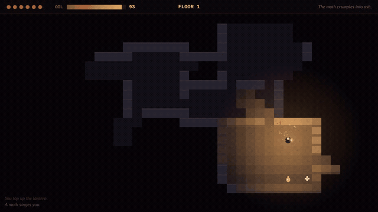

# Wick

A turn-based roguelike where your lantern's oil is your field of view.



Every floor is generated from a seed. You need the stairs, and you only see what your lantern lights. Oil burns as you walk, and the light shrinks with it. Three things live down here, and each one reacts to the light differently: moths fly at it, shades flee its bright core and wait at the edge for it to go out, and hounds ignore it and hunt you by sound.

**Project page:** [fishraposo.github.io/projects/wick.html](https://fishraposo.github.io/projects/wick.html)

**Play:** in the browser on itch.io *(link added after upload)*, or run it locally:

```bash
git clone https://github.com/FishRaposo/wick.git
cd wick
npm start            # serves the folder at http://localhost:8080
```

## Controls

| | Keyboard | Gamepad | Touch / mouse |
|---|---|---|---|
| Move | arrows, WASD or HJKL | d-pad or left stick | tap toward where you want to go |
| Wait a turn | space, `.` or Z | A | tap yourself |
| Attack | walk into it | | |
| Mute | M | | |

## How it plays

- **Oil is time and sight.** A full lantern lights 7 tiles. It burns one point every two turns, and the radius drops a tile every 20 oil. At zero you see one tile around you. Flasks on the floor restore 30.
- **Moths** notice a burning lantern from a little beyond its glow and fly at it, erratically. They lose interest when it's dry.
- **Shades** can't stand the bright core of the light (all but its outer two tiles). They flee it along a flee map, stalk just outside it, and can only reach you once the lantern is out.
- **Hounds** hunt by sound. A footstep carries 5 steps along the corridors, an attack 7, and waiting is silent. A hound goes to where it heard you, then sniffs around. Sound travels along the dungeon, not through rock.
- Walking into a wall is free: no turn passes, no oil burns.

## Under the hood

No engine, no dependencies, no asset files: about 1,400 lines of plain JavaScript on a 2D canvas, with synthesized sound.

- **The rules are a pure module.** `src/rules.js` holds the whole game as a state object and `act(state, action)`, with no DOM, timers or rendering. The browser layer reads the events each turn produces to animate and play sound. That split is why the tests and the task checks run in Node against exactly the code the browser runs.
- **Floor generation** (`src/gen.js`): rooms by rejection sampling, joined left to right with L-shaped corridors so every room is reachable, plus one or two extra corridors so the map has loops. The stairs go on the tile farthest from the start by walking distance.
- **Field of view** (`src/fov.js`): recursive shadowcasting over eight octants. Walls are lit, what's behind them isn't, and the radius test uses r² + r for rounder circles.
- **AI on Dijkstra maps** (`src/path.js`): one BFS distance map to the player per turn drives approach. Shades walk downhill on a flee map, built Brogue-style by scaling the distance map by −1.2 and relaxing it, which sends them toward open space instead of into dead ends. Hounds hear on a BFS from the noise.
- **Seeded and deterministic.** Every random choice goes through a seeded PRNG, so `?seed=31` replays the same floors and the same enemy decisions for the same inputs.

The design reasoning is in [docs/DESIGN.md](docs/DESIGN.md).

## Task pack

[`tasks/`](tasks/README.md) holds three game-development tasks built on this game:

- **Hounds hear through walls**: a planted AI bug.
- **Enemies follow the player downstairs**: a planted state bug.
- **Pour oil**: a feature that touches actions, lighting, two enemy AIs, rendering, input and audio.

Each has a brief, acceptance criteria, a reference solution with root-cause notes and an automated check. `npm run tasks` proves every check fails on the starting state and passes on the solution, with the whole unit suite green.

## Tests

```bash
npm test         # 18 tests: generation over 1,800 floors, FOV shape and walls, flee maps, each enemy's behaviour, turn rules
npm run check    # syntax check of every module
npm run tasks    # the task pack
```

`scripts/smoke.py` plays the real page headlessly (title, several floors, tap input, death, restart) and fails on any console error.

## Project layout

```
src/rules.js     the game: state, turns, enemy AI (no DOM)
src/gen.js       floor generation
src/fov.js       shadowcasting field of view
src/path.js      distance maps, flee maps, downhill steps
src/grid.js      grid helpers and the text-map parser tests use
src/config.js    every tunable number
src/render.js    drawing
src/main.js      input, animation, game states
src/audio.js     synthesized sound effects
test/            node:test suites
tasks/           the task pack and its verifier
```

## Limitations

- No diagonal movement: four directions keep the controls and the AI readable.
- No save; a run is one sitting.
- Tested in Chromium. Firefox and Safari use only standard canvas and WebAudio APIs but haven't been verified.

## License

[MIT](LICENSE)
